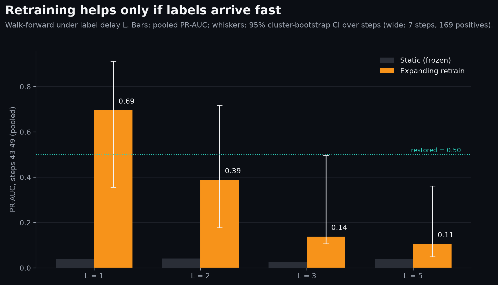
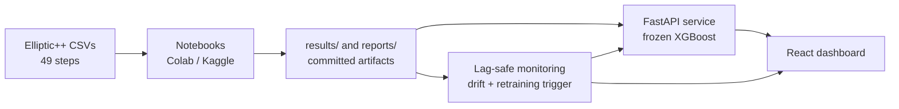

# BitcoinGraphGuard

[](https://github.com/siddhu-exe/BitcoinGraphGuard/actions/workflows/test.yml)
[](https://github.com/siddhu-exe/BitcoinGraphGuard/actions/workflows/model-consistency-check.yml)
[](https://github.com/siddhu-exe/BitcoinGraphGuard/actions/workflows/docker-build.yml)


**A Bitcoin fraud detector that knows when to stop trusting itself.**

Built on the real [Elliptic++](https://github.com/git-disl/EllipticPlusPlus) dataset (203,769
transactions, 822,942 wallets, about 4.4M edges, 49 time steps), and evaluated the way it would be
used: train on the past, test on the future, and watch what happens when the world changes.

**Live demo:** https://bitcoin-graph-delta.vercel.app &nbsp;·&nbsp; **API:** https://bitcoingraphguard.onrender.com
(`/docs` for the interactive reference; the free tier may take a moment to wake up)



## Three findings

1. **A tuned XGBoost beat every graph neural network.** Test PR-AUC on steps 35-49 is **0.80**
   (0.8013) for XGBoost against **0.62** (0.6209) for the best graph model, GraphSAGE.
2. **All four models collapsed after step 43.** XGBoost scores 0.9215 PR-AUC on steps 35-42 and
   **0.04** (0.0427) on steps 43-49, as illicit prevalence drops from 9.16% to 2.53%. GraphSAGE, HGT
   and HeteroRGCN end between 0.0386 and 0.0550 on the same window. The step-43 drop is already
   documented by the original Elliptic work (Weber et al., 2019); the contribution here is measuring
   it on every model and diagnosing it.
3. **Retraining recovers performance only if labels arrive fast.** PR-AUC on steps 43-49 with
   expanding-window retraining, against 0.0406 for the frozen model:

   | Label delay L (steps) | 1 | 2 | 3 | 5 |
   | :--- | ---: | ---: | ---: | ---: |
   | Expanding retrain, PR-AUC | **0.6949** | 0.3878 | 0.1377 | 0.1050 |
   | 95% cluster CI | 0.3559-0.9120 | 0.1771-0.7184 | 0.1063-0.4949 | 0.0489-0.3614 |

   Verdict `PARTIAL`: the model is restored (PR-AUC 0.50) only at the one-step delay. Details in
   [`docs/WALKFORWARD.md`](docs/WALKFORWARD.md).

Supporting diagnosis: a classifier separates steps 1-34 from 43-49 perfectly (AUC 1.0000), yet
cross-validation *inside* 43-49 reaches PR-AUC 0.9199, so the signal is present and the
distribution transfer fails ([`docs/OOD_DIAGNOSIS.md`](docs/OOD_DIAGNOSIS.md)).

## What was built

- **Data and graph pipeline.** Transactions and wallets joined by four directed edge types, split
  strictly by time (fit 1-24, validate 25-34, refit 1-34, test 35-49), with class 3 (unknown) never
  used as supervision.
- **Four models under one protocol.** XGBoost, GraphSAGE, HeteroRGCN and a heterogeneous graph
  transformer (HGT), plus MLP, logistic-regression and prevalence baselines.
- **Explainability.** SHAP for XGBoost; Captum/GNNExplainer and relation ablation for the graph
  models.
- **Lag-safe drift monitor.** A decision at step `t` reads labels of steps `<= t - L` only. At a
  one-step delay the label-free score-shift channel fires at step 43 (score PSI 0.609 in the deployed
  monitor's backtest) and the performance channel at step 44; no critical alarm fires during steps
  35-42. Validated on one drift event.
- **Walk-forward retraining** under label delay, with top-K triage instead of a fixed threshold.
- **Serving.** FastAPI service for the frozen XGBoost model with a per-step `confidence_context`,
  packaged with Docker, tested with 49 pytest tests, and gated by three GitHub Actions workflows.
- **React dashboard** (live link above) reading the API and exported artifacts.

**Stack:** Python, XGBoost, PyTorch Geometric, SHAP, Captum, FastAPI, Pydantic, Docker, GitHub
Actions, React 18, TypeScript, Vite, Recharts, Render, Vercel, Google Colab / Kaggle.

## Results

Test steps 35-49, pooled over all labeled test transactions (16,670, of which 1,083 illicit).
PR-AUC is the primary metric because prevalence is 6.5% overall.

| Model | PR-AUC | ROC-AUC | F1 (illicit) |
| :--- | ---: | ---: | ---: |
| **XGBoost, optimized (served)** | **0.8013** | 0.9281 | 0.7818 |
| GraphSAGE (homogeneous GNN) | 0.6209 | 0.9044 | 0.5945 |
| HGT (heterogeneous transformer) | 0.4861 | 0.8937 | 0.3106 |
| 2-layer MLP | 0.4768 | 0.8912 | 0.5759 |
| HeteroRGCN (heterogeneous GNN) | 0.4682 | 0.8946 | 0.5295 |
| Logistic regression | 0.2917 | 0.8828 | 0.4385 |
| Prevalence baseline | 0.0650 | 0.5000 | 0.1220 |

Sources: `results/heterogeneous_gnn/metrics.json`, `results/hgt/metrics.json`. The XGBoost F1 in
`results/xgboost/metrics.json` is 0.7799; PR-AUC and ROC-AUC agree.

XGBoost at its validation-selected threshold `tau* = 0.435`:

| Window | Steps | Illicit prevalence | PR-AUC | Recall |
| :--- | :--- | ---: | ---: | ---: |
| Early test | 35-42 | 9.16% | 0.9215 | 794 / 914 |
| Late test (drift) | 43-49 | 2.53% | 0.0427 | 5 / 169 |

## How it fits together



- **Heavy ML runs off-laptop.** Every dataset load, graph build and training run lives in a
  per-phase notebook generated by `scripts/generate_notebook_*.py` and executed on Colab or Kaggle.
- **Serving is tabular only.** The API loads the frozen XGBoost model once at startup and excludes
  PyTorch, PyG and MLflow.
- **Monitoring is lag-safe.** A `LagViolationError` blocks any decision that would read a label that
  has not arrived. Of nine candidate signals, only some were worth acting on; see
  `reports/monitoring_signal_evaluation.md`, which also lists what did not work.

## Quickstart

Python 3.10–3.12. You do **not** need the raw dataset to run the API, tests or dashboard;
the model and report artifacts are committed.

```bash
git clone git@github.com:siddhu-exe/BitcoinGraphGuard.git
cd BitcoinGraphGuard
uv venv .venv && source .venv/bin/activate
uv pip install -r requirements-serving.txt
```

**Run the API**

```bash
uvicorn src.api.main:app --reload --port 8000
curl http://localhost:8000/health
```

Interactive docs are at `http://localhost:8000/docs`. `POST /predict` takes a `time_step`
and the 165 Elliptic++ transaction features by name; `tests/test_api.py::SAMPLE_TX_1813992_FEATURES`
is a complete working payload (transaction 1813992 at step 35 scores about `1.7188735e-05`).

| Endpoint | Purpose |
| :--- | :--- |
| `GET /health` | Model, feature and metrics-source status |
| `POST /predict` | Score one transaction, with a `confidence_context` for its time step |
| `POST /batch_predict` | Score many (capped by `MAX_BATCH_SIZE`) |
| `GET /monitoring/status` | Latest monitoring decision, with the label-delay assumption |

**Run with Docker** (CPU-only, 1.5 GB memory cap)

```bash
docker compose up --build
```

**Run the tests and lint**

```bash
pytest -q
ruff check --force-exclude --config .github/ruff-ci.toml src/api src/monitoring tests
```

**Run the dashboard**

```bash
cd frontend && npm install && npm run dev
```

**Reproduce the experiments**

The raw CSVs go in `Og data/` (gitignored, read-only). Verify them with a memory-safe
streaming check, then regenerate and run a phase notebook on Colab or Kaggle:

```bash
python scripts/verify_dataset.py
python scripts/generate_notebook_09.py   # writes notebooks/09_walkforward_retraining.ipynb
```

## Repository layout

| Path | Contents |
| :--- | :--- |
| `notebooks/` | One notebook per phase, `01_eda` through `09_walkforward_retraining` |
| `scripts/` | Notebook generators, dataset verification, monitoring backtest and evaluation |
| `src/api/` | FastAPI inference service and model loader |
| `src/monitoring/` | Drift engines, lag-safe decision rules, retraining trigger, backtest |
| `frontend/` | React 18 + Vite + TypeScript dashboard |
| `results/`, `reports/` | Saved metrics and reports from executed runs; every number above traces here |
| `tests/` | Pytest suite for the API and monitoring |
| `docs/` | Architecture, per-phase write-ups, CI/CD, roadmap |
| `.github/workflows/` | Tests, model-consistency gates, Docker build |

## Limitations

- **One drift event.** Elliptic++ contains a single regime change, and the monitor and retraining
  results are validated on it only. Steps 43-49 hold 169 illicit transactions, so intervals are wide.
- **Real label delay is unknown.** The study reports L = 1, 2, 3 and 5 instead of assuming one.
- **XGBoost is the deployed model.** The graph models are benchmarked, not served, and they were
  tuned less deeply, so the gap is a result for this protocol and not a claim about graph methods.
- **Split-leakage concerns.** The literature notes that Elliptic's temporal and graph structure can
  leak across naive splits. This project uses strict temporal splits and a leak audit
  (`docs/OOD_DIAGNOSIS.md`), but results are on one dataset and one era (2016-17 activity).
- **Precomputed features only.** The API needs the 165 Elliptic++ features, so it cannot score a
  raw transaction hash.
- **`confidence_context` is not a probability of being right.** It maps the caller's `time_step` to
  a historical regime label (`reliable`, `degraded`, `unknown`).

## Documentation

- [`docs/WALKFORWARD.md`](docs/WALKFORWARD.md): retraining under label delay
- [`docs/OOD_DIAGNOSIS.md`](docs/OOD_DIAGNOSIS.md): drift diagnosis and leak audit
- [`docs/ARCHITECTURE.md`](docs/ARCHITECTURE.md): system design and the compute split
- [`docs/XGBOOST.md`](docs/XGBOOST.md), [`docs/GRAPHSAGE_V2.md`](docs/GRAPHSAGE_V2.md),
  [`docs/HETEROGENEOUS_GNN.md`](docs/HETEROGENEOUS_GNN.md), [`docs/HGT.md`](docs/HGT.md): model records
- [`docs/EXPLAINABILITY.md`](docs/EXPLAINABILITY.md): SHAP, Captum and relation ablation
- [`docs/CI_CD.md`](docs/CI_CD.md), [`DEPLOY.md`](DEPLOY.md): CI gates and deployment
- [`docs/PROGRESS.md`](docs/PROGRESS.md), [`docs/IMPROVEMENT_PLAN.md`](docs/IMPROVEMENT_PLAN.md): status and open work
- [`AGENTS.md`](AGENTS.md): contributor and agent rules

## References

- Weber et al., *Anti-Money Laundering in Bitcoin: Experimenting with Graph Convolutional
  Networks for Financial Forensics*, KDD Workshop on Anomaly Detection in Finance, 2019.
- Elmougy & Liu, *Demystifying Fraudulent Transactions and Illicit Nodes in the Bitcoin
  Network for the Post-Processing Era*, KDD, 2023 (Elliptic++).
