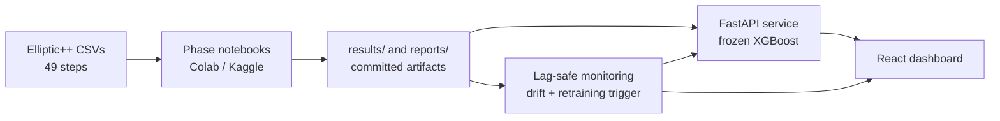

# BitcoinGraphGuard

[](https://github.com/siddhu-exe/BitcoinGraphGuard/actions/workflows/test.yml)
[](https://github.com/siddhu-exe/BitcoinGraphGuard/actions/workflows/model-consistency-check.yml)
[](https://github.com/siddhu-exe/BitcoinGraphGuard/actions/workflows/docker-build.yml)


**Bitcoin fraud detection on the real [Elliptic++](https://github.com/git-disl/EllipticPlusPlus)
dataset, evaluated the way it would be used: train on the past, test on the future, and
watch what happens when the world changes.**

Elliptic++ is a temporal heterogeneous graph of ~203k transactions and ~823k wallet
addresses over 49 time steps. This repo benchmarks tabular and graph models on it, diagnoses
why every model collapses in the last seven steps, tests whether retraining can recover, and
serves the best model behind a FastAPI service with drift monitoring.

## Key findings

- **A well-tuned XGBoost beats every graph model tried.** Test PR-AUC (steps 35–49) is 0.8013
  for XGBoost versus 0.6209 for GraphSAGE, 0.4861 for HGT and 0.4682 for HeteroRGCN, all
  evaluated under the same frozen temporal protocol (see Limitations on tuning depth).
- **Every model fails at the regime shift.** From step 43 illicit prevalence drops from 9.16%
  to 2.53% and the aggregate features shift. XGBoost PR-AUC falls from 0.9215 (steps 35–42)
  to 0.0427 (steps 43–49). The step-43 drop is already documented in the original Elliptic
  work (Weber et al., 2019); the contribution here is measuring it on every model and
  diagnosing it.
- **It is covariate drift, not a vanished signal.** A classifier separates steps 1–34 from
  43–49 perfectly (AUC 1.0000), yet cross-validation *inside* 43–49 reaches PR-AUC 0.9199.
- **Retraining helps, but only if labels arrive fast.** With a one-step label delay an
  expanding-window retrain lifts steps 43–49 to PR-AUC 0.6949; at a three-step delay it
  reaches 0.1377. Verdict: `PARTIAL`.

## Results

Protocol: fit on steps 1–24, validate on 25–34, refit on 1–34, test on 35–49 (16,670 labeled
transactions, 1,083 illicit). No random splits, and unlabeled class-3 nodes are never used as
supervision. PR-AUC is the primary metric because prevalence is 6.5% overall.

| Model | PR-AUC | ROC-AUC | F1 (illicit) |
| :--- | ---: | ---: | ---: |
| **XGBoost, optimized (served)** | **0.8013** | 0.9281 | 0.7818 |
| GraphSAGE (homogeneous GNN) | 0.6209 | 0.9044 | 0.5945 |
| HGT (heterogeneous transformer) | 0.4861 | 0.8937 | 0.3106 |
| 2-layer MLP | 0.4768 | 0.8912 | 0.5759 |
| HeteroRGCN (heterogeneous GNN) | 0.4682 | 0.8946 | 0.5295 |
| Logistic regression | 0.2917 | 0.8828 | 0.4385 |
| Prevalence baseline | 0.0650 | 0.5000 | 0.1220 |

Pooled over all test transactions. Sources: `results/heterogeneous_gnn/metrics.json`,
`results/hgt/metrics.json`. The XGBoost F1 recorded in `results/xgboost/metrics.json` is
0.7799; the difference is in the third decimal and the PR-AUC and ROC-AUC agree.

### The regime shift (steps 43–49)

XGBoost at its validation-selected threshold `tau* = 0.435`:

| Window | Steps | Illicit prevalence | PR-AUC | Recall |
| :--- | :--- | ---: | ---: | ---: |
| Early test | 35–42 | 9.16% | 0.9215 | 794 / 914 |
| Late test (drift) | 43–49 | 2.53% | 0.0427 | 5 / 169 |

Adversarial validation, a leak audit and a permutation check are in `docs/OOD_DIAGNOSIS.md`
and `results/ood_diagnosis/`. The separation is spread across many `Aggregate_feature_*`
columns rather than a single timestamp proxy.

### Retraining under label delay

`notebooks/09_walkforward_retraining.ipynb` retrains walk-forward under a lag-safe rule: to
predict step `t`, only labels from steps `<= t - L` are used.

| Policy | Label delay L | Steps 43–49 PR-AUC [95% CI] |
| :--- | ---: | :--- |
| Static (frozen model) | 1 | 0.0406 [0.0248, 0.0943] |
| Expanding window | 1 | 0.6949 [0.3559, 0.9120] |
| Expanding window | 3 | 0.1377 [0.1063, 0.4949] |

Intervals are cluster bootstraps over time steps. They are wide because the window has seven
steps and 169 positives, two of the steps holding 5 and 2. Details: `results/walkforward/`
(read its `README.md` first; the window-level ceilings in `alert_budget.csv` are wrong).

## How it fits together



- **Heavy ML runs off-laptop.** Every dataset load, graph build and training run lives in a
  per-phase notebook generated by `scripts/generate_notebook_*.py` and executed on Colab or
  Kaggle. The laptop is for development, tests, serving and docs.
- **Serving is tabular only.** The API loads the frozen XGBoost model once at startup and
  deliberately excludes PyTorch, PyG and MLflow.
- **Monitoring is lag-safe.** A decision at step `t` reads labels from steps `<= t - L` only,
  and a `LagViolationError` enforces it. Channels are rolling performance and prevalence
  (label-dependent), score-shift PSI (label-free) and local-feature PSI (warning only).
  Of nine candidate signals, only some were worth acting on: see
  `reports/monitoring_signal_evaluation.md`, which also lists what did not work.

## Quickstart

Python 3.10–3.12. You do **not** need the raw dataset to run the API, tests or dashboard;
the model and report artifacts are committed.

```bash
git clone git@github.com:siddhu-exe/BitcoinGraphGuard.git
cd BitcoinGraphGuard
uv venv .venv && source .venv/bin/activate
uv pip install -r requirements-serving.txt
```

**Run the API**

```bash
uvicorn src.api.main:app --reload --port 8000
curl http://localhost:8000/health
```

Interactive docs are at `http://localhost:8000/docs`. `POST /predict` takes a `time_step`
and the 165 Elliptic++ transaction features by name; `tests/test_api.py::SAMPLE_TX_1813992_FEATURES`
is a complete working payload (transaction 1813992 at step 35 scores about `1.7188735e-05`).

| Endpoint | Purpose |
| :--- | :--- |
| `GET /health` | Model, feature and metrics-source status |
| `POST /predict` | Score one transaction, with a `confidence_context` for its time step |
| `POST /batch_predict` | Score many (capped by `MAX_BATCH_SIZE`) |
| `GET /monitoring/status` | Latest monitoring decision, with the label-delay assumption |

**Run with Docker** (CPU-only, 1.5 GB memory cap)

```bash
docker compose up --build
```

**Run the tests and lint**

```bash
pytest -q
ruff check --force-exclude --config .github/ruff-ci.toml src/api src/monitoring tests
```

**Run the dashboard**

```bash
cd frontend && npm install && npm run dev
```

**Reproduce the experiments**

The raw CSVs go in `Og data/` (gitignored, read-only). Verify them with a memory-safe
streaming check, then regenerate and run a phase notebook on Colab or Kaggle:

```bash
python scripts/verify_dataset.py
python scripts/generate_notebook_09.py   # writes notebooks/09_walkforward_retraining.ipynb
```

## Repository layout

| Path | Contents |
| :--- | :--- |
| `notebooks/` | One notebook per phase, `01_eda` through `09_walkforward_retraining` |
| `scripts/` | Notebook generators, dataset verification, monitoring backtest and evaluation |
| `src/api/` | FastAPI inference service and model loader |
| `src/monitoring/` | Drift engines, lag-safe decision rules, retraining trigger, backtest |
| `frontend/` | React 18 + Vite + TypeScript dashboard |
| `results/`, `reports/` | Saved metrics and reports from executed runs; every number above traces here |
| `tests/` | Pytest suite for the API and monitoring |
| `docs/` | Architecture, per-phase write-ups, CI/CD, roadmap |
| `.github/workflows/` | Tests, model-consistency gates, Docker build |

## Limitations

- **Precomputed features only.** The API needs the 165 Elliptic++ features, so it cannot
  score a raw transaction hash.
- **Near-random in the drift window.** At the frozen threshold, steps 43–49 are poorly
  ranked. The API labels that regime but cannot repair it.
- **`confidence_context` is not a probability of being right.** It maps the caller's
  `time_step` to a historical regime label (`reliable`, `degraded`, `unknown`).
- **Small late-window sample.** Steps 43–49 hold 169 illicit transactions, so per-step
  metrics carry wide uncertainty.
- **One dataset, one era.** Elliptic++ covers one regime change in 2016–17 activity. Monitoring
  thresholds were validated on this backtest only.
- **Graph models were not tuned to the same depth as XGBoost.** Treat the gap as a result for
  this protocol, not a general claim about graph methods.

## Documentation

- [`docs/ARCHITECTURE.md`](docs/ARCHITECTURE.md): system design and the compute split
- [`docs/OOD_DIAGNOSIS.md`](docs/OOD_DIAGNOSIS.md): drift diagnosis and leak audit
- [`docs/XGBOOST.md`](docs/XGBOOST.md), [`docs/GRAPHSAGE_V2.md`](docs/GRAPHSAGE_V2.md),
  [`docs/HETEROGENEOUS_GNN.md`](docs/HETEROGENEOUS_GNN.md), [`docs/HGT.md`](docs/HGT.md): model records
- [`docs/EXPLAINABILITY.md`](docs/EXPLAINABILITY.md): SHAP, Captum and relation ablation
- [`docs/CI_CD.md`](docs/CI_CD.md), [`DEPLOY.md`](DEPLOY.md): CI gates and Render deployment
- [`docs/IMPROVEMENT_PLAN.md`](docs/IMPROVEMENT_PLAN.md): what remains to be done
- [`AGENTS.md`](AGENTS.md): contributor and agent rules

## References

- Weber et al., *Anti-Money Laundering in Bitcoin: Experimenting with Graph Convolutional
  Networks for Financial Forensics*, KDD Workshop on Anomaly Detection in Finance, 2019.
- Elmougy & Liu, *Demystifying Fraudulent Transactions and Illicit Nodes in the Bitcoin
  Network for the Post-Processing Era*, KDD, 2023 (Elliptic++).
